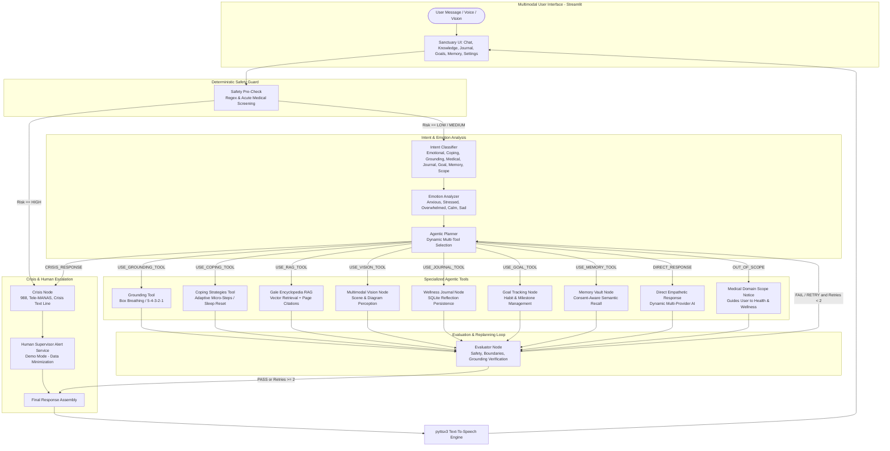

# MINDLY: Autonomous Multimodal Mental-Wellness & Study Companion

> **MINDLY (v2.0 Full Production Release)**  
> *Dynamic Multi-Provider AI + Gale Encyclopedia RAG + Multimodal Voice & Vision + Persistent Memory + Wellness Journal + Goal Tracking + Medical Scope Boundary Guard + Human Supervisor Escalation + Evaluator Loop*  
> An autonomous multi-agent mental-wellness platform demonstrating dynamic tool orchestration, knowledge grounding from the *Gale Encyclopedia of Medicine*, multimodal voice & vision, long-term user memory, and clinical safety boundaries.

---

## 1. Executive Summary & System Definition

**Mindly** is an empathetic, agentic multimodal mental-wellness companion engineered for students and individuals navigating everyday academic stress, emotional fatigue, anxiety, and burnout.

Unlike static prompt-and-response chatbots, Mindly implements a true **Agentic Cognitive Loop**:
```
UNDERSTAND → ANALYZE → DECIDE → PLAN → SELECT TOOL → EXECUTE → EVALUATE → REPLAN → RESPOND
```

Mindly accepts **Text**, **Voice** (microphone recording & audio notes), and **Vision** (drawings, journal photos, environment pictures), and dynamically determines which processing pipelines and tools to execute.

> **Clinical Safety & Scope Boundary**: Mindly is an educational and emotional support system. It is strictly non-clinical, never diagnoses conditions or prescribes medication, immediately redirects out-of-scope technical/financial inquiries back to health/wellness, and directs high-risk situations to verified crisis services (988, Tele-MANAS, Crisis Text Line) and human project supervisors in demo mode.

---

## 2. System Architecture



---

## 3. Key Dynamic Features

| Subsystem | Implementation | Purpose & User Benefit |
|---|---|---|
| **Multi-Provider LLM Engine** | Ollama / Groq / OpenAI / Dynamic Local | Dynamic, personalized generation without static canned phrases across all environments. |
| **Domain Scope Boundary Guard** | Regex & Intent Pre-filter | Politely redirects out-of-scope queries (coding, finance, mechanics) back to health/wellness. |
| **Gale Encyclopedia RAG** | Vector Store + NumPy Cosine Search | Evidence-based health information grounded in verified medical literature with page citations. |
| **Multimodal Voice Input** | `st.audio_input` & Audio Transcriber | Speak directly into your microphone or upload audio files for speech-to-text processing. |
| **Voice Speech Synthesis** | Local pyttsx3 Engine | Gentle audio voice generation for replies with automatic emoji and markdown cleaning. |
| **Multimodal Vision** | PIL Inspector & Ollama Vision | Upload diagrams, notes, or scenery with dynamic perception and educational disclaimers. |
| **Reflection Journal & Analytics** | SQLite + Streamlit Metrics | Private journal with automatic mood distribution insights and reflection metrics. |
| **Goal & Habit Tracker** | SQLite with Status Updates | Set study milestones, track completion percentage with a visual progress bar, and complete goals. |
| **Consent-Aware Memory Vault** | Key-Value Preference Store | Mindly remembers your preferred name and personal habits when enabled, with one-click forget. |
| **Acute Medical Urgency Screen** | Pre-routing Clinical Filter | Detects severe red flags (e.g., chest pain, internal bleeding) and advises urgent clinical care. |
| **Human Supervisor Alert** | Non-emergency notification simulation | In demo mode, logs high-risk alerts with minimal data exposure to protect user privacy. |

---

## 4. Hierarchical 10-Level Routing Architecture

Mindly routes incoming messages through a deterministic priority hierarchy (Priorities 0 through 9):

```
Priority 0: Empty or Invalid Input           -> Prompt user for clarification
Priority 1: High-Risk Safety (Self-Harm)    -> Crisis Node + Supervisor Alert (Bypasses normal routing)
Priority 2: Acute Medical Red Flags         -> Urgent Clinical Evaluation Advisory
Priority 3: Physical Health Inquiry         -> Gale Encyclopedia RAG Knowledge Retrieval
Priority 4: Third-Person / Educational Risk -> Educational Crisis Protocol (No False Escalation)
Priority 5: Reflection Journal Request      -> SQLite Journal Creation / Retrieval
Priority 6: Goal / Habit Request            -> SQLite Goal Management & Progress Tracking
Priority 7: Explicit Grounding Request      -> Somatic Exercises (Box Breathing / 5-4-3-2-1)
Priority 8: Coping & Emotional Support      -> Actionable Micro-Steps & Grounded Validation
Priority 9: Scope Notice / General Chat     -> Scope Advisory or Dynamic Conversational Companion
```

---

## 5. Local Setup & Quickstart

For a detailed local walkthrough, see [HOW_TO_RUN_LOCALLY.md](HOW_TO_RUN_LOCALLY.md).

### 1. Activate Environment & Install Dependencies
```bash
# Windows
.\.venv\Scripts\Activate.ps1

# Linux / macOS
source .venv/bin/activate

# Install requirements
pip install -r requirements.txt
```

### 2. Ingest Knowledge Base
```bash
python ingest.py
```

### 3. Run Web Application
```bash
streamlit run app.py
```
Open **`http://localhost:8501`** in your browser.

---

## 6. Configuration (.env)

| Variable | Default Value | Description |
|---|---|---|
| `LLM_PROVIDER` | `auto` | `auto` (best available), `ollama` (local only), `groq`, or `openai` |
| `LLM_FALLBACK_ENABLED` | `true` | When `true`, gracefully degrades to rule-synthesis on failure; when `false`, shows diagnostic error |
| `OLLAMA_MODEL` | `llama3.2:1b` | Primary local text model in Ollama |
| `OLLAMA_MAX_TOKENS` | `512` | Default generation token budget (configurable; prevents abrupt truncation) |
| `TOKEN_BUDGET_GREETINGS` | `150` | Fast token budget for greetings and brief check-ins (~1-2s latency) |
| `TOKEN_BUDGET_NORMAL` | `512` | Standard token budget for complete, fully explained answers |
| `TOKEN_BUDGET_DETAILED` | `1024` | Expanded token budget for multi-step guides and Gale clinical RAG |
| `GROQ_API_KEY` | *(empty)* | Optional free Groq API key for ultra-fast Llama 3.3 70B inference |
| `OPENAI_API_KEY`| *(empty)* | Optional OpenAI API key for GPT-4o-mini |
| `VISION_MODEL` | `llava` | Local vision model name in Ollama |
| `OLLAMA_BASE_URL` | `http://localhost:11434` | Ollama service endpoint |
| `MAX_EVAL_RETRIES` | `2` | Maximum replan iterations before final response |
| `KNOWLEDGE_DIR` | `data/knowledge` | Directory containing medical reference PDFs |
| `VECTOR_DB_DIR` | `data/vectorstore` | Persistent vector store index directory |
| `DB_PATH` | `data/app.db` | SQLite database file for memory, journal, and goals |
| `ESCALATION_MODE` | `demo` | Escalation mode (`demo` simulated or `production`) |

### Local Performance & Query Latency Optimization
When running locally with CPU inference (e.g. `llama3.2:1b` on laptops):
- **Bounded Classification Tokens**: Intent and emotion classification nodes use `max_tokens=20`, completing classification in ~0.2-0.5s rather than reserving 512 tokens.
- **Dynamic Budgets**: Greetings complete in ~1.5s (150 tokens), standard questions complete in ~4-6s (512 tokens), and detailed medical RAG plans complete in ~10-20s (768-1024 tokens).
- **Zero Paid Key Requirement**: Works 100% offline via local Ollama. Adding a free [Groq Cloud Key](https://console.groq.com) reduces inference latency to <1.0s.

---

## 7. Clinical & Ethical Boundaries

Mindly is designed with strict boundaries to ensure user safety:
1. **Non-Diagnostic**: Never issues clinical diagnoses (e.g., *"You have appendicitis"* or *"You have major depression"*).
2. **Non-Prescriptive**: Never prescribes medication dosages, pharmaceuticals, or treatments.
3. **Deterministic Safety Override**: High-risk expressions cannot be bypassed or downgraded by LLM hallucination.
4. **Data Minimization**: Escalation alerts log minimal trigger snippets rather than private conversation transcripts.
5. **Educational Framing**: All medical citations are explicitly labeled as educational reference material derived from the *Gale Encyclopedia of Medicine*.
